<!-- ═════════════ HEADER BANNER ═════════════ -->
<div align="center">



<br/>

<a href="https://www.linkedin.com/in/rushikesh-jagtap-07b787376/"></a>
<a href="https://leetcode.com/u/Rushi_28/"></a>
<a href="https://github.com/Rushikesh282006"></a>


<br/><br/>

**✨ Consistent. Curious. Building with Intelligence. ✨**

</div>

<br/>

<!-- ═════════════ AT A GLANCE ═════════════ -->
<div align="center">

| 🎓 Academics | 🧠 Focus | 🏆 Hackathons | 🤝 Open To |
|:---:|:---:|:---:|:---:|
| **9.7 CGPA**<br/>3rd-year IT Engineering | **End-to-end ML pipelines**<br/>& AI-integrated backends | **SIH 2025 & 2026**<br/>Shortlisted · Top-10 Hack & Track | **Open-source collabs**<br/>with reciprocal teamwork |

</div>

<br/>

<!-- ═════════════ ABOUT ═════════════ -->
## 🚀 About Me

```python
class Rushikesh:
    role     = "Python Backend Developer · ML Engineer"
    studying = "B.E. Information Technology (3rd year)"
    building = ["Multi-tenant RAG platforms", "ML pipelines", "Scalable FastAPI services"]
    exploring = ["Graph Neural Networks", "Advanced ML architectures"]
    looking_for = "Impactful open-source projects & authentic teamwork"
```

<br/>

<!-- ═════════════ TECH STACK ═════════════ -->
## 💻 Tech Stack

<div align="center">


<br/>

<br/>


</div>

<br/>

<details open>
<summary><b>📚 Full breakdown</b></summary>

<br/>

| Area | Technologies |
|:--|:--|
| **Languages** | `Python` `Java` `C` |
| **Backend** | `FastAPI` `Pydantic` `SQLAlchemy` `Celery` `Redis` |
| **AI / ML / Data** | `TensorFlow` `Scikit-learn` `Pandas` `NumPy` `LLMs` `RAG Architecture` `Vector DBs` |
| **Frontend** | `HTML5` `CSS3` `JavaScript` `React` `Tailwind CSS` |
| **Databases** | `MySQL` `MongoDB` `PostgreSQL (pgvector)` |
| **Tools** | `Git` `GitHub` `Postman` `Power BI` `Docker` `Antigravity` |

</details>

<br/>

<!-- ═════════════ PROJECTS ═════════════ -->
## 🛠️ Featured Projects

### 📄 Multi-Tenant Document RAG Platform

       

> A document question-answering app designed to keep each user's documents and retrieval context **fully isolated**.

<div align="center">

</div>

- 📥 PDF ingestion and background processing with **Celery + Redis**
- 🔍 **Hybrid retrieval**: pgvector similarity search + PostgreSQL full-text search, fused with **Reciprocal Rank Fusion**
- ⚡ Responses streamed via **Server-Sent Events**, with **source-page citations**
- 🔐 Tenant-scoped data access at both the application and database layer

<a href="https://github.com/Rushikesh282006/Document_Rag"></a>
<a href="https://document-rag-olive.vercel.app/"></a>

<br/>

### 🎭 Emotion Scanner

    

> Text-based emotion classification across **six emotion categories**, returning confidence scores.

<div align="center">

</div>

- 🧠 Trained a custom **Bidirectional GRU** model for text classification
- 📦 Converted to **TensorFlow Lite** and served behind a FastAPI endpoint
- 💬 Web interface for real-time text predictions

<a href="https://github.com/Rushikesh282006/Emotion_Predictor"></a>
<a href="https://emotion-predictor-j013.onrender.com/"></a>

<br/>

### 🏠 House Price Predictor

     

> End-to-end regression app for estimating California house values from single inputs or **batch CSV uploads**.

<div align="center">

</div>

- 🌲 Random Forest model trained on the California Housing dataset (**20,640 records**)
- ✅ Prediction endpoints with Pydantic validation and batch CSV support
- 📈 Performance: **R² ≈ 0.805** · **MAE ≈ $32,800**

<a href="https://github.com/Rushikesh282006/House_Price_Predictor"></a>
<a href="https://house-price-predictor-gd9p.onrender.com/"></a>

<br/>

<!-- ═════════════ GOALS ═════════════ -->
## 🎯 Currently Leveling Up

<div align="center">

| 🧩 Algorithmic Thinking | 🏗️ Robust Backends | 🔬 Advanced ML |
|:---:|:---:|:---:|
| Solving DSA patterns to sharpen problem-solving | Building scalable, backend-driven AI/ML systems | Exploring Graph Neural Networks & modern architectures |

</div>

<br/>

<!-- ═════════════ ACHIEVEMENTS ═════════════ -->
## 🏆 Hackathons & Achievements

- 🇮🇳 **Smart India Hackathon** — 2× shortlisted (SIH 2025 & SIH 2026) in the college internal qualifier
- 🥇 **Hack & Track** — Top-10 team, organized by Fr. Agnel College, Vashi
- 🎓 **Academic Excellence** — Ranked **2nd** in the IT branch in both 1st and 2nd year

<br/>

<!-- ═════════════ LIVE DASHBOARD ═════════════ -->
## 📡 Live Dashboard

<div align="center">



<br/><br/>



<br/>

<sub>🔄 Redrawn every 3 hours by a GitHub Action, straight from the GitHub and LeetCode APIs</sub>

</div>

<br/>

<!-- ═════════════ FOOTER ═════════════ -->
<div align="center">

### 💬 Let's build something great together

<a href="https://www.linkedin.com/in/rushikesh-jagtap-07b787376/"></a>

<sub>Built with curiosity · Mumbai, India 🇮🇳</sub>

</div>
